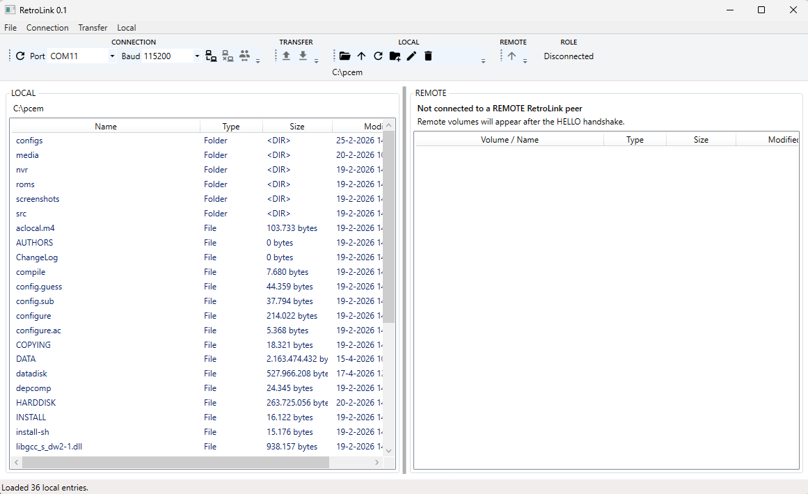
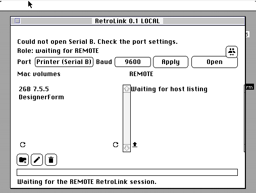

# RetroLink

RetroLink is a serial file-transfer application with Windows, classic
Macintosh, and MS-DOS peers. More peers will be added later. The tool is meant 
for file transfer from any, to any target. Most logically it will be used to 
transfer from a Windows PC to a legacy target, but it's perfectly possible to
connect MS-DOS to Macintosh, or Commodore 64 to CP/M. (Those targets are a 
work in progress currently, but it's always good to have a goal in mind)

## Terminology

In user-facing labels and documentation, **LOCAL** is the machine running the
interface and **REMOTE** is its connected peer. The Windows app therefore
shows its selected folder as LOCAL and the connected device as REMOTE; target
firmware uses the same terms from its own point of view.

## Windows

Requires Windows 10/11 x64 and the .NET 10 SDK.



```powershell
dotnet build RetroLink.slnx --configuration Release
dotnet run --project src/RetroLink/RetroLink.csproj
dotnet test tests/ClassicMacIde.Core.Tests/ClassicMacIde.Core.Tests.csproj
```

For a self-contained Windows executable:

```powershell
./scripts/windows/publish-retrolink-release.ps1
```

The output is `RELEASE/Windows/RetroLink.exe`. NuGet packages are restored
during the first build. Serial communication requires a physical COM port or
a separately installed virtual null-modem driver.

## Classic Macintosh



## Other Platforms

- [DOS and Macintosh build environment setup](docs/setup-environment.md)
- [Classic Macintosh build](docs/macintosh-build.md): checked-in C/Rez
  sources in `macintosh/src`; requires Retro68 under WSL Ubuntu.
- [MS-DOS build and tests](src/RetroLink.Dos/README.md): requires Open Watcom;
  DOSBox-X is optional for emulator testing.
- [Platform status and release notes](RELEASE/README.md).
- [Documentation index](docs/README.md).

`src/ClassicMacIde.Core` retains its original namespace and project name for
compatibility, but contains only RetroLink protocol, checksum, and XMODEM
dependencies. No designer, IDE UI, or sibling-project reference is included.

ROMs, system disks, emulator binaries, compiler installations, and generated
outputs are not included. The source is licensed under [GPLv3](LICENSE).
